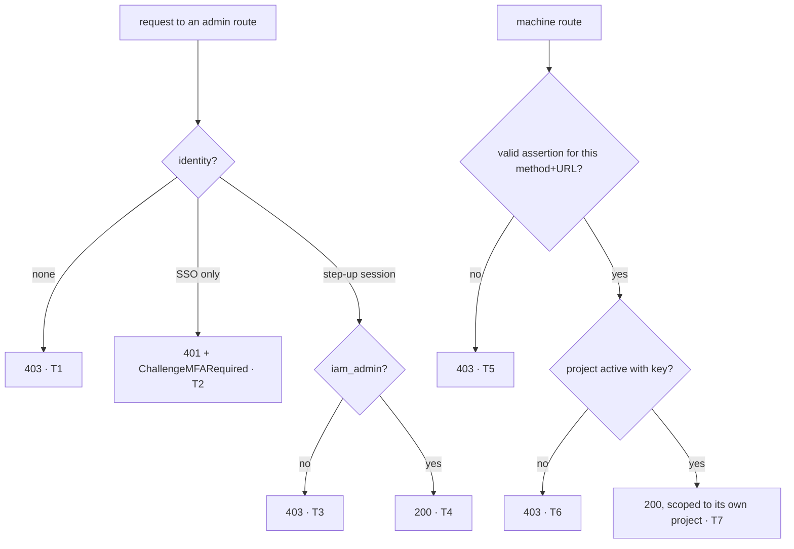

> Read AGENTS.md at the repo root before any change.

# Plan — iam: bank-grade access control

Read `AGENTS.md` first. One correction to it: its "Qué es / Restricción #1"
still describes `routes/routes.go`. Routes now live in `config/routes.go`.
Stage 9 fixes the doc.

Master plans: `https://github.com/webtyp/docs/blob/main/SECURITY_BY_DEFAULT_MASTER_PLAN.md`
(stages 1–9) and `https://github.com/webtyp/docs/blob/main/DEPLOY_WIZARD_MASTER_PLAN.md`
(stages 10–12, and the deploy text of stage 9). Everything you need is restated here.

## Why — the audit (2026-10-12), verified against the running server

| # | Severity | Finding | Fixed in stage |
|---|---|---|---|
| F1 | Critical | Session cookie `Domain=.velty.cl`: every `*.velty.cl` server receives the admin's cookie and can replay it server-side, forging `Origin`/`Sec-Fetch-Site` (only browsers guarantee those). Any compromised sibling app takes over the admin panel. | 4 |
| F2 | High | 22 of 25 routes are `.Public()` and protected by hand-written wrappers (`RequirePanelAdmin`, `VerifyProjectSecret`). One forgotten wrapper means an open endpoint, and `/_routes` / the API explorer report `public`. | 2, 3 |
| F3 | High | `session/jwt`: stateless, 7 days, logout cannot revoke. | 4 |
| F5 | High | Admin = Google login + email in `IAM_ADMIN_EMAILS`. Single factor. | 4, 5 |
| F6 | Medium | Consumers authenticate with a shared `client_secret` in the JSON body. | 6 |
| F7 | Medium | `/_routes` is public in production. | 3 |
| F9 | Medium | `AssignRole` and `ResolveUser` (machine mutations) write no audit entry. | 7 |
| F10 | Low | `/api/health/db` is public. | 3 |

Why each fix is the industry answer:
- **Deny-by-default enforced by the framework** (Spring
  `anyRequest().authenticated()`, ASP.NET `FallbackPolicy`; ASVS V1.4.4/V4.1.3).
- **Phishing-resistant MFA for admins** (PCI DSS 4.0 req. 8.4.2; NIST AAL3).
- **Host-only privileged session with step-up** (GitHub sudo mode, AWS
  console; ASVS V3.4.4).
- **Revocable sessions with idle and absolute limits** (ASVS V3.3; PCI 8.2.8;
  NIST 800-63B §7.2).
- **Machine clients as principals with `private_key_jwt`** (RFC 7523,
  FAPI 2.0).
- **Token exchange for acting on behalf of a user** (RFC 8693).
- **An inventory of every public route** (OWASP API9:2023).

## Dependencies (each must be tagged; if a symbol is missing, stop)

| Module | Symbols used |
|---|---|
| `webtyp.com/router` | `Route.RequiresMFA()`, `router.HeaderWWWAuthenticate`, `router.ChallengeMFARequired`, `routertest.AssertPublicRoutes`, `RouteInfo.MFA` |
| `webtyp.com/server` | `httpd` enforcing `RequiresMFA` |
| `webtyp.com/cloudflare` | `edge` enforcing `RequiresMFA` |
| `webtyp.com/auth` | `auth.SessionPolicy`, `auth.Principal`, `cookie.New(repo, cookie.Options{...})`, `authority.Module.SetStepUpStrategy`, `passkey.New`, `passkey.Path*`, `passkey.ChallengeRecentLogin`, `clientassertion.New`, `clientassertion.ClientKeys`; `session/jwt` **no longer exists** |
| `webtyp.com/jwt` | `jwt.NewClientAssertion`, `jwt.SignClientAssertion` |
| `webtyp.com/webauthn` | browser `webauthn.Create`/`Get`; `webauthn/server.RelyingParty` |
| `webtyp.com/crypto` | `asym.GenerateKeyPair` |
| `webtyp.com/model` | `model.Assurance*` |
| `webtyp.com/deploy` | `deploy.Plan`, `deploy.Database`, `deploy.Var`, `deploy.Secret`, `deploy.Typed`, `deploy.Random`, `deploy.ToRuntime`, `deploy.ToLocal`, `deploy.Scan` |
| `webtyp.com/goflare` | `goflare.Worker`; the action input `d1-name` (it exports `D1_DATABASE_ID` to `pre-deploy` itself) |
| `webtyp.com/github` | `github.Actions` |

`go get webtyp.com/router@latest webtyp.com/server@latest webtyp.com/cloudflare@latest webtyp.com/auth@latest webtyp.com/jwt@latest webtyp.com/webauthn@latest webtyp.com/crypto@latest webtyp.com/model@latest webtyp.com/deploy@latest webtyp.com/goflare@latest webtyp.com/github@latest`.

## Constraints (from AGENTS.md, restated)

- Everything `edge/main.go` imports transitively, which today is all of
  `config/`, compiles with **TinyGo for the Worker**: **no `map`**, no
  `fmt`/`errors`/`strconv`/`strings`/`log`/`os` (use `webtyp/fmt`,
  `webtyp/env`), `webtyp/json` (no `encoding/json`), no `reflect`. `tests/`
  is standard Go and exempt: do not "fix" its imports.
- `edge.wasm` must stay **< 1 MB**. Size is checked by hand: after the change,
  build it and report the size in the PR description.
- Never recreate a library symbol locally. If one is missing, stop.
- No loose CSS classes in the panel. Styles go through `webtyp/widget/style`
  in a `css.go` (`!wasm`), and components come from `webtyp/components`.
- Code in English. User-facing panel text in Spanish (existing convention).
- Tests in `tests/`. Run `gotest`.
- Every repeated string is a named constant.

## Stage 1 — policy vocabulary (`config/policy.go`, new)

```go
const (
	// IAMProjectID is iam's own project in rbac: the roles below live here.
	IAMProjectID = "iam"

	RoleIAMAdmin  model.RoleCode = "iam_admin"  // humans who run the panel
	RoleIAMClient model.RoleCode = "iam_client" // consumer apps (machine principals)

	ResourceProject   model.Resource = "iam_project"
	ResourceRole      model.Resource = "iam_role"
	ResourceUserRole  model.Resource = "iam_user_role"
	ResourceAudit     model.Resource = "iam_audit"
	ResourceRoutes    model.Resource = "iam_routes"
	ResourceHealth    model.Resource = "iam_health"
	ResourceToken     model.Resource = "iam_token"
	ResourceIdentity  model.Resource = "iam_identity"
	ResourceRoleGrant model.Resource = "iam_role_grant"
)

// Authorizer answers router's Authorize for iam's own routes.
func Authorizer(rbacSvc *rbac.Service) model.Authorizer {
	return func(userID string, r model.Resource, a model.Action) bool {
		return rbacSvc.Can(IAMProjectID, userID, r, a)
	}
}

// EnsurePolicy creates both roles and their permissions idempotently, and
// grants RoleIAMAdmin to every email in adminEmails (creating the user if
// needed, via the existing EnsureRole). IAM_ADMIN_EMAILS is a SEED: removing
// an email does not revoke. Revocation is done in the panel and audited.
func EnsurePolicy(rbacSvc *rbac.Service, authMod *authority.Module, adminEmails []string) error
```

Permissions (use `rbacSvc.CreatePermission` + `AssignPermission`; ignore
"already exists" errors with the existing `isAlreadyExistsErr`):

| Role | Resource | Actions |
|---|---|---|
| `iam_admin` | `iam_project` | Create, Read, Update |
| `iam_admin` | `iam_role` | Create, Read, Update, Delete |
| `iam_admin` | `iam_user_role` | Create, Read, Delete |
| `iam_admin` | `iam_audit` | Read |
| `iam_admin` | `iam_routes` | Read |
| `iam_admin` | `iam_health` | Read |
| `iam_client` | `iam_token` | Create |
| `iam_client` | `iam_identity` | Create |
| `iam_client` | `iam_role_grant` | Create |

Use one permission per (resource, action set), combining actions with the
`model.Action` bit mask. Permission and role ids are deterministic
constants (e.g. `"perm_iam_admin_project"`, `"role_iam_admin"`), so
re-running is idempotent.

Where it runs: in `NewProductionBackend` and the local backend, right after
auth/rbac are built. **Why not in `cmd/migrate`**: `goflare.NewD1Migrator`
returns a `ddl.Execer` that runs DDL only and cannot run the orm queries
seeding needs. The cost is ~2 + 2N D1 queries per isolate cold start
(N = admin emails). They are idempotent and data, not schema. Write this
justification in the function comment.

Every time a project is created (stage 6), grant `RoleIAMClient` in
`IAMProjectID` to the project id (`rbacSvc.AssignRoleByCode(IAMProjectID, projectID, RoleIAMClient)`).
The project id **is** the machine principal's user id: the client-assertion
authenticator sets `ctx.UserID()` to it.

## Stage 2 — composition roots get an Authorizer

1. New `config/server.go` (`//go:build !wasm`):
   ```go
   // RunServer is the local development server. webtyp's generator sees it and
   // writes web/server.go as `config.RunServer()`.
   func RunServer() error
   ```
   It builds the local backend exactly as `registerLocal` does today. It
   then builds
   `httpd.New(httpd.Config{Port: DevPort, PublicDir: DevPublicDir, Gzip: true, Health: true, TLS: httpd.TLSConfig{PlainHTTP: false}, Authn: backend.Auth.Authenticate(), Authorize: Authorizer(backend.RBAC)})`,
   calls `RegisterRoutes(s.Router(), backend, adminEmails)` and then
   `s.ListenAndServe()`. Constants: `DevPort = "8080"`,
   `DevPublicDir = "web/public"`.
2. `web/server.go`: replace its content with exactly what the generator
   emits for `RunServer` mode:
   ```go
   //go:build !wasm

   package main

   import (
   	"log"

   	"github.com/veltylabs/iam/config"
   )

   func main() {
   	if err := config.RunServer(); err != nil {
   		log.Fatal(err)
   	}
   }
   ```
3. Delete `config/routes_server.go`, `config/routes_wasm.go` and `func Register`
   (`config/routes.go`). There is one way to start iam locally: `RunServer`.
4. `edge/main.go`: `edge.NewRouter(edge.Config{Authn: backend.Auth.Authenticate(), Authorize: config.Authorizer(backend.RBAC)})`,
   then `config.RegisterRoutes(r, backend, config.PanelAdminList())`.
5. `RegisterRoutes` signature becomes
   `func RegisterRoutes(r router.Router, b *Backend, adminEmails []string)`.
   The `Backend` carries everything the old 8 parameters did. Update
   `tests/` callers.
6. Remove `r.Use(authMod.Authenticate())` from `RegisterRoutes`: Authn is now
   the server's `Config.Authn` (both httpd and edge run it before the gate).

## Stage 3 — the route table (`config/routes.go`)

Every route, with nothing left to the handler:

| Method · path | Declaration |
|---|---|
| `GET /api/health` | `.Public()` |
| `GET /api/health/db` | `.Requires(ResourceHealth, model.Read)` |
| `POST /api/token` | `.Requires(ResourceToken, model.Create)` |
| `POST /api/users/resolve` | `.Requires(ResourceIdentity, model.Create)` |
| `POST /api/roles/assign` | `.Requires(ResourceRoleGrant, model.Create)` |
| `GET /api/admin/me` | `.Authenticated()`: it answers about the caller (stage 5) |
| `GET /api/admin/projects` | `.Requires(ResourceProject, model.Read).RequiresMFA()` |
| `POST /api/admin/projects` | `.Requires(ResourceProject, model.Create).RequiresMFA()` |
| `POST /api/admin/projects/key` (replaces `/rotate`) | `.Requires(ResourceProject, model.Update).RequiresMFA()` |
| `POST /api/admin/projects/active` | `.Requires(ResourceProject, model.Update).RequiresMFA()` |
| `GET /api/admin/roles` | `.Requires(ResourceRole, model.Read).RequiresMFA()` |
| `POST /api/admin/roles` | `.Requires(ResourceRole, model.Create).RequiresMFA()` |
| `POST /api/admin/roles/ttl` | `.Requires(ResourceRole, model.Update).RequiresMFA()` |
| `POST /api/admin/roles/delete` | `.Requires(ResourceRole, model.Delete).RequiresMFA()` |
| `GET /api/admin/roles/users` | `.Requires(ResourceUserRole, model.Read).RequiresMFA()` |
| `POST /api/admin/users/assign` | `.Requires(ResourceUserRole, model.Create).RequiresMFA()` |
| `POST /api/admin/users/revoke` | `.Requires(ResourceUserRole, model.Delete).RequiresMFA()` |
| `GET /api/admin/audit` | `.Requires(ResourceAudit, model.Read).RequiresMFA()` |
| `GET /_routes` | `router.MountIntrospection(r, router.IntrospectionPath, nil).Requires(ResourceRoutes, model.Read).RequiresMFA()` |
| auth's own routes | mounted by `authMod.MountAPI(r)` (logout, OAuth, passkey: their access is declared by `auth`) |

- Rename `PathAdminProjectRotate` → `PathAdminProjectKey = "/api/admin/projects/key"`.
- Admin mutations keep `RequireSameOrigin` as a browser-CSRF defense in depth:
  `SameSite=Strict` still sends a host-only cookie on requests initiated by a
  sibling subdomain page, because that page is same-site. Turn it into a
  route middleware: keep the function, but wrap only the handler. It no longer
  receives `adminEmail`: read the email from `authMod.GetUser(ctx.UserID())`
  when auditing.
- Delete `RequirePanelAdmin`, `adminPost`, `IsPanelAdmin`. Keep
  `PanelAdminList` (used by `EnsurePolicy`). Handlers that took
  `(ctx, adminEmail string)` become plain `router.HandlerFunc`s and get the
  email through `authMod.GetUser(ctx.UserID())` where they audit.
- Delete `modules/admin/` entirely. It only re-exports `config` symbols as
  package variables (a second path to the same functions). Tests import
  `config` instead.

## Stage 4 — sessions: opaque, revocable, two scopes (`config/auth.go`, `config/auth_local.go`)

1. Delete the `sessionjwt` import and its strategy.
2. SSO strategy (consumers read it; single factor):
   ```go
   sso, err := cookie.New(authMod, cookie.Options{
   	Name: CookieSession, Domain: SSOCookieDomain,
   	Policy: auth.SessionPolicy{Absolute: SSOSessionAbsolute, Idle: SSOSessionIdle, Assurance: model.AssuranceSingleFactor},
   	TrustProxy: true,
   })
   authMod.SetStrategy(sso)
   ```
   `SSOSessionAbsolute = 12 * 3600`, `SSOSessionIdle = 30 * 60` (NIST AAL2).
   Delete `SSOSessionTTL` and `TTLSession`.
3. Admin step-up strategy (host-only, so the cookie is `__Host-iam_admin`):
   ```go
   stepUp, err := cookie.New(authMod, cookie.Options{
   	Name: CookieAdmin,
   	Policy: auth.SessionPolicy{Absolute: AdminSessionAbsolute, Idle: AdminSessionIdle, Assurance: model.AssuranceMultiFactor},
   	TrustProxy: true,
   })
   authMod.SetStepUpStrategy(stepUp)
   ```
   `CookieAdmin = "iam_admin"`, `AdminSessionAbsolute = 8 * 3600`,
   `AdminSessionIdle = 15 * 60` (PCI 8.2.8, NIST AAL3).
4. Passkeys: `rp := server.RelyingParty{ID: <host of b.Origin>, Origin: b.Origin}`;
   `pk, err := passkey.New(db, ids, authMod, rp)`; `authMod.Enable(pk)`.
   Extract the host with a small helper in `config` (`originHost`: strip the
   `https://` or `http://` prefix and any `:port`), with a test.
5. The same composition applies to the local backend (`auth_local.go`). There,
   `b.Origin` is `LocalPanelOrigin`.
6. `Backend.PanelOrigin` is renamed `Backend.Origin`: it is iam's exact
   origin, used as the panel origin, the WebAuthn origin and the
   client-assertion audience. The env var stays `IAM_PANEL_ORIGIN`. Document
   the three uses on the constant. Delete `Backend.JWTSecret`'s use for
   sessions (it remains only for signing authorization tokens, stage 6).

## Stage 5 — admin entry and panel flow

1. `AdminMeResponse` becomes
   `{Email, Name string; IsAdmin, HasPasskey, MultiFactor bool}`:
   - `IsAdmin = rbacSvc.Can(IAMProjectID, uid, ResourceProject, model.Read)`;
   - `HasPasskey`: count the user's passkeys. Use the query `auth/passkey`
     exposes; if it exposes none, **stop and report**, do not query its table
     from iam;
   - `MultiFactor = ctx.Assurance() == model.AssuranceMultiFactor`.
2. `web/client.go` flow (status of `GET /api/admin/me`):
   - 403 → anonymous: show the existing login link.
   - 200 and `!IsAdmin` → `ShowStatus("Tu cuenta no tiene acceso al panel de administración.")`.
   - 200, admin, `!HasPasskey` → enrollment view: one button "Registrar passkey".
   - 200, admin, `HasPasskey && !MultiFactor` → step-up view: one button
     "Verificar con passkey".
   - 200, admin, `MultiFactor` → `panel.Boot(me)`.
3. New `modules/panel/passkey.go` (`//go:build wasm`). Both buttons run their
   ceremony in a goroutine started from the click handler (the `webauthn`
   package requires a user gesture and must not block the main goroutine):
   - enroll: `POST passkey.PathRegisterOptions` → `webauthn.Create(...)` with
     `UserVerification: "required"`, `ResidentKey: true` →
     `POST passkey.PathRegister` with `RawResponse` → then run verify;
   - verify: `POST passkey.PathVerifyOptions` → `webauthn.Get(...)` with
     `UserVerification: "required"` → `POST passkey.PathVerify` → on 204,
     reload `GET /api/admin/me`.
   - A 401 whose `WWW-Authenticate` equals `passkey.ChallengeRecentLogin`
     shows "Inicia sesión de nuevo para registrar tu passkey" and the login link.
4. Every panel API call goes through one helper (add it to
   `modules/panel/support.go`): a 401 with
   `WWW-Authenticate == router.ChallengeMFARequired` (the admin session idled
   out) switches to the step-up view instead of showing an error.
5. Styles: buttons are `webtyp/components` (actionbutton), and any layout
   goes in `modules/panel/css.go` with `widget/style`. No loose classes.

## Stage 6 — machine clients: `private_key_jwt` and token exchange

1. `Project` model (`config/models.go` + regenerate `config/models_orm.go`
   with `ormc`): replace `ClientSecretHash string` with
   `ClientPublicKey string // base64url SPKI DER, P-256`. Existing rows get an
   empty key and are treated as inactive until an admin registers one (see
   the deploy note).
2. Delete from `config/projects.go`: `GenerateClientSecret`,
   `hashProjectSecret`, `projectSecretKey`, `projectSecretKeyLabel`,
   `clientSecretBytes`, `clientSecretPrefix`, `RegenerateProjectSecret`,
   `VerifyProjectSecret`, plus the env key they read for the pepper (find it in
   `projects.go` and delete its constant). Add:
   ```go
   // SetProjectKey registers (or replaces) a project's public key. It refuses a
   // key that is not base64url of a P-256 SPKI. Validation:
   // asym.VerifyCompact([]byte("probe"), make([]byte, 64), key) returns a
   // non-nil error exactly when the key does not parse as a P-256 public key
   // (the all-zero signature itself just yields ok == false, nil).
   func SetProjectKey(db *orm.DB, projectID, publicKeyB64 string) error
   // ClientPublicKey implements clientassertion.ClientKeys: active project with a
   // non-empty key → decoded SPKI; otherwise an error (IsProjectNotFound for
   // unknown ids, a typed inactive error otherwise).
   func (k ProjectKeys) ClientPublicKey(clientID string) ([]byte, error)
   type ProjectKeys struct{ DB *orm.DB }
   ```
   `CreateProject(db, id, name, publicKeyB64)` validates the key the same way.
3. Wire the authenticator in both backends:
   `ca, err := clientassertion.New(db, ProjectKeys{DB: db}, b.Origin, authMod.Notify)`;
   `authMod.Enable(ca)`. A request with `Authorization: Bearer` is then a
   machine request: cookies are ignored, and `ctx.UserID()` is the project id.
4. Handlers:
   - `Token` (token exchange, RFC 8693): body
     `{"subject_token": "<SSO session id>"}` (`TokenRequest{SubjectToken}`;
     delete `ProjectID`/`ClientSecret`). `projectID := ctx.UserID()`.
     `sess, err := authMod.GetSession(body.SubjectToken)` → on error 401 and
     audit `AuditTokenDenied`. Issue the authorization token for
     `sess.UserId` in `projectID`, as today.
   - `ResolveUser`: body `{email, name}`; delete `ProjectID`/`ClientSecret`.
   - `AssignRole`: body `{user_id, role_code}`; the project is
     `ctx.UserID()`. A client can only grant roles in its own project.
5. Admin endpoints: `POST /api/admin/projects` takes `{name, public_key}`;
   `POST /api/admin/projects/key` takes `{project_id, public_key}`. Delete
   `AdminSecretResponse` and the panel's `renderSecret`. The projects panel
   shows a "Clave pública" input on create, and a "Cambiar clave pública" action.
6. New `cmd/keygen/main.go` (`!wasm`, thin): `asym.GenerateKeyPair()`, then
   print to **stdout**:
   ```
   IAM_CLIENT_PRIVATE_KEY=<base64url SEC1 private key>
   public_key=<base64url SPKI public key>
   ```
   Print to **stderr** one line: store the private key as a secret of the
   consumer; paste the public key in the iam panel. No arguments → do it.
   `-h` → usage. Exit 0.
7. `client/` (the consumer library):
   - `Config{BaseURL, ProjectID string; PrivateKey []byte}`;
   - `EnvClientPrivateKey = "IAM_CLIENT_PRIVATE_KEY"` (base64url SEC1)
     replaces `EnvClientSecret`;
   - `ConfigFromEnv` decodes it; `New` rejects an empty key
     (`ErrMsgMissingPrivateKey = "iam client: Config.PrivateKey is required"`).
   - Every call to iam signs a fresh assertion with
     `jwt.NewClientAssertion(ProjectID, BaseURL, method, BaseURL+path)` +
     `jwt.SignClientAssertion(PrivateKey, a)` and sends
     `Authorization: Bearer <token>`. One unexported helper does this for all
     calls.
   - **`Consumer` becomes the only public entry point** (one way to consume
     iam). Its methods: `Authn()`, `Scope(userID)`, `AssignRole(...)` (exist)
     and a new `ResolveUser(email, name string) (string, error)`. The package
     functions `FetchAuthzToken` and `ResolveUser` become unexported
     (`fetchAuthzToken`, `resolveUser`), and `Consumer` calls them. Consumers
     (misitio) build **one** `Consumer` at startup.
   - The token call posts `{"subject_token": ssoCookieValue}` and **no longer
     forwards a Cookie header**.
   - The resolve and assign calls get the same bearer change.
   - The client compiles inside consumer Workers (TinyGo): same restrictions
     as `config/`.

## Stage 7 — audit machine mutations

`AssignRole` → `RecordAudit(db, ids, projectID, AuditRoleGrantedByClient, userID+":"+roleCode, "")`.
`ResolveUser`, when it creates a user →
`RecordAudit(db, ids, projectID, AuditIdentityCreatedByClient, email, "")`.
Add both action constants next to the existing `Audit*` ones.

## Stage 8 — tests

Delete tests that only exist for removed code (secret hashing/rotation,
`RequirePanelAdmin`, `modules/admin` imports), **after** porting every
assertion that still applies to the new mechanism. List each deleted test
and its replacement in the PR description.

New `tests/access_matrix_test.go` drives the **real** `RegisterRoutes` on
`router/mock` with `Authorize: config.Authorizer(rbac)` and a real
`authority.Module` (`orm` over `storage/mem`), then:



| Branch | Case |
|---|---|
| T1 | every `/api/admin/*` except `me`, plus `/_routes` and `/api/health/db`: anonymous → 403 |
| T2 | same routes with an SSO session only → 401, header `router.ChallengeMFARequired` |
| T3 | step-up session of a non-admin → 403 |
| T4 | step-up session of an admin → 200 on each GET route |
| T5 | `/api/token` with no bearer; with an assertion for another URL (`htu`); replayed assertion |
| T6 | assertion signed by a project marked inactive; by a project with no key |
| T7 | `AssignRole` assigns in the calling project only (a body cannot name another project); `ResolveUser` works; `Token` exchanges a valid SSO session id and rejects an invalid one with 401 |
| inventory | `routertest.AssertPublicRoutes(t, r, "GET /api/health", "POST /logout", "GET /oauth/google", "GET /oauth/callback/google")`. If auth registers another public login route, add it **only** if it is an OAuth/login entry point of `auth`'s `MountAPI`, and name it in the PR description |
| `/api/admin/me` | anonymous → 403; SSO → 200 `IsAdmin` per role, `MultiFactor=false`; step-up → `MultiFactor=true` |
| `EnsurePolicy` | idempotent: run twice, same role/permission counts; an admin email gets `iam_admin` |
| `originHost` | `https://iam.velty.cl` → `iam.velty.cl`; `https://localhost:8080` → `localhost` |
| `SetProjectKey` | garbage key rejected; valid SPKI accepted |
| `client` | `Consumer.Authn()` against an `httptest` server running iam's routes: sends a bearer, no Cookie header, the server accepts it, and `ctx.UserID()` is the user. `Consumer.ResolveUser` and `Consumer.AssignRole` work against the same server |
| CSRF defense in depth | step-up admin POST with `Sec-Fetch-Site: same-site` and a sibling `Origin` → 403 |

Use real passkey responses in tests the same way the `webauthn/server` tests
build them (`asym.GenerateKeyPair`, authenticatorData + clientDataJSON +
`asym.Sign`). Copy those envelope helpers into `tests/passkey_helpers_test.go`.

## Stage 9 — docs and deploy note

1. `AGENTS.md`: fix the structure section (routes in `config/routes.go`,
   `config/server.go` RunServer, no `modules/admin`). Add "Access: every route
   declares `.Requires`/`.Authenticated`/`.Public`; admin routes add
   `.RequiresMFA()`; the public inventory test is the gate for new public
   routes".
2. `docs/ARCHITECTURE.md`: §6.4 (client credentials → `private_key_jwt`), §7
   (two sessions, two scopes), §8.2 (admins = `iam_admin` role seeded from
   `IAM_ADMIN_EMAILS`), §8.7 (CSRF: why the Origin check stays). Replace the
   affected paragraphs. Do not keep the old text "for history".
3. `docs/DEPLOY.md`: replace the variables table (`docs/DEPLOY.md:50-58`) and every
   `gh secret set` instruction with: open iam in `webtyp`, DEPLOY tab, follow the checklist (it is
   built from `config/deploy.go`, stage 11); Google's OAuth client is the one manual step and the
   checklist shows its exact steps. Then a section "Despliegue de la ola de seguridad", in order:
   1. deploy iam (DEPLOY tab);
   2. run `go run ./cmd/keygen` for each consumer;
   3. the consumer declares `IAM_CLIENT_PRIVATE_KEY` in its own `config/deploy.go`
      (`Source: deploy.Typed`, `To: ToRuntime`); its developer types the private key in that
      consumer's DEPLOY tab — never in `.env`, a chat or a dashboard;
   4. register the public key in the iam panel (the first admin enrolls a passkey within 5
      minutes of a fresh Google login);
   5. deploy the consumer;
   6. the consumer removes `IAM_CLIENT_SECRET` from its declaration.

   Until step 4, consumer calls get 403. Delete every mention of `D1_DATABASE_ID` as a GitHub
   secret.
4. `README.md`: env vars table (`IAM_CLIENT_SECRET` gone,
   `IAM_CLIENT_PRIVATE_KEY` for consumers).

## Stage 10 — workflow on the new goflare inputs

`.github/workflows/deploy.yml` (the `d1-name: velty-iam-db` input is already there):

- `uses: tinywasm/goflare@v1` → `uses: webtyp/goflare@v1`.
- Delete the job-level env line `D1_DATABASE_ID: ${{ secrets.D1_DATABASE_ID }}`: goflare resolves
  the database by name and exports `D1_DATABASE_ID` to `pre-deploy` itself, so `cmd/migrate` does
  not change.

Nothing else in the file changes (`webtyp/app` regenerates it from `config/deploy.go` later).

## Stage 11 — `config/deploy.go`

New file, exactly. The build tag keeps the deployment tools out of every binary of iam;
`deploy.Scan` reads it by AST and accepts **only literals** (that is why the two Google guides are
written out twice).

```go
//go:build deploy

package config

import (
	"webtyp.com/deploy"
	"webtyp.com/github"
	"webtyp.com/goflare"
	"webtyp.com/lang"
)

// Deploy declares how iam is deployed. webtyp reads it without running it.
func Deploy() deploy.Plan {
	return deploy.Plan{
		Name:      "iam",
		Domain:    "iam.velty.cl",
		Target:    goflare.Worker,
		CI:        github.Actions,
		Databases: []deploy.Database{{Binding: "DB", Name: "velty-iam-db"}},
		Vars: []deploy.Var{
			{Key: "GOOGLE_REDIRECT_URL", Value: "https://iam.velty.cl/oauth/callback/google"},
			{Key: "IAM_PANEL_ORIGIN", Value: "https://iam.velty.cl"},
		},
		Secrets: []deploy.Secret{
			{
				Key:    "GOOGLE_CLIENT_ID",
				What:   "Identifier of iam's OAuth client at Google",
				Source: deploy.Typed,
				Guide: []lang.Text{
					"Open https://console.cloud.google.com/apis/credentials in the project that owns iam's login",
					"Create credentials, OAuth client ID, type Web application (or open the existing one)",
					"Authorized redirect URI: https://iam.velty.cl/oauth/callback/google",
					"Copy the value shown here",
				},
				To: []deploy.Place{deploy.ToRuntime},
			},
			{
				Key:    "GOOGLE_CLIENT_SECRET",
				What:   "Password of iam's OAuth client at Google",
				Source: deploy.Typed,
				Guide: []lang.Text{
					"Open https://console.cloud.google.com/apis/credentials in the project that owns iam's login",
					"Create credentials, OAuth client ID, type Web application (or open the existing one)",
					"Authorized redirect URI: https://iam.velty.cl/oauth/callback/google",
					"Copy the value shown here",
				},
				To: []deploy.Place{deploy.ToRuntime},
			},
			{
				Key:    "JWT_SECRET",
				What:   "Key that signs the authorization tokens",
				Source: deploy.Random,
				To:     []deploy.Place{deploy.ToRuntime, deploy.ToLocal},
			},
			{
				Key:    "IAM_ADMIN_EMAILS",
				What:   "Comma-separated emails seeded as iam_admin",
				Source: deploy.Typed,
				Guide:  []lang.Text{"Type the admin emails separated by commas"},
				To:     []deploy.Place{deploy.ToRuntime},
			},
		},
	}
}
```

Every key must equal the constant iam reads after stages 1–9 (`EnvGoogleClientID`,
`EnvGoogleClientSecret`, `EnvGoogleRedirectURL`, `EnvJWTSecret`, `EnvPanelOrigin`,
`EnvAdminEmails`). If stages 1–9 removed one of those variables, drop its entry; if they added
one, add it (secret → `Secrets`, not secret → `Vars`) and say so in the PR. `go mod tidy`.

## Stage 12 — declaration test

`tests/deploy_declaration_test.go`: `deploy.Scan("..")` returns `Name == "iam"`,
`Target == deploy.TargetID("webtyp.com/goflare.Worker")`, one database `velty-iam-db`, the two
`Vars`, and every `Secret.Key` / `Var.Key` equals one of the `config.Env*` constants. And
`go vet -tags deploy ./config/` succeeds (skip with the reason if `go` is not on PATH).

## Stages

| # | Files | Done when |
|---|---|---|
| 1 | `go.mod`, `go.sum`, `config/policy.go` | compiles |
| 2 | `config/server.go`, `web/server.go`, `edge/main.go`, `config/routes.go`; delete `config/routes_server.go`, `config/routes_wasm.go` | local and edge build with an Authorizer |
| 3 | `config/routes.go`, `config/api.go`, `config/admin_handlers.go`, `config/admin_origin.go`, `config/adminaccess.go`; delete `modules/admin/` | no `.Public()` outside the inventory |
| 4 | `config/auth.go`, `config/auth_local.go`, `config/backend.go`, `config/backend_local.go` | opaque sessions, step-up, passkeys wired |
| 5 | `config/panelapi.go`, `web/client.go`, `modules/panel/passkey.go`, `modules/panel/support.go`, `modules/panel/css.go`, `modules/panel/projects.go` | panel flow works in the browser |
| 6 | `config/models.go`, `config/models_orm.go`, `config/projects.go`, `config/routes.go`, `cmd/keygen/main.go`, `client/client.go`, `client/consumer.go` | machine path works end to end |
| 7 | `config/audit.go`, `config/routes.go` | audit rows written |
| 8 | `tests/access_matrix_test.go`, `tests/passkey_helpers_test.go`, every test touched by the removals | all branches T1–T7 green |
| 9 | `AGENTS.md`, `docs/ARCHITECTURE.md`, `docs/DEPLOY.md`, `README.md` | docs match code |
| 10 | `.github/workflows/deploy.yml` | no `D1_DATABASE_ID` secret |
| 11 | `config/deploy.go` (new), `go.mod`, `go.sum` | `go vet -tags deploy ./config/` passes |
| 12 | `tests/deploy_declaration_test.go` (new) | declaration test green |

## Acceptance criteria

- `gotest` green.
- `grep -n "D1_DATABASE_ID" .github/workflows/deploy.yml` → empty.
- `GOOS=js GOARCH=wasm go list -deps ./edge/ | grep -E "goflare|webtyp.com/github|webtyp.com/deploy"` → empty.
- `grep -n "gh secret set" docs/DEPLOY.md` → empty.
- `grep -rn "\.Public()" config/` → only `PathHealth`.
- `grep -rn "RequirePanelAdmin\|VerifyProjectSecret\|ClientSecret\|sessionjwt\|IsPanelAdmin" --include=*.go .` → empty.
- `grep -n "^func FetchAuthzToken\|^func ResolveUser" client/*.go` → empty (only `Consumer` is public).
- `test -d modules/admin` → false.
- `GOOS=js GOARCH=wasm` builds of `./edge/` and `./web/` succeed, and the PR
  description states the `edge.wasm` size (must be < 1 MB).
- Before opening the PR: `git diff --stat main` lists every file of the
  stages table, and no file is deleted that this plan does not order deleted.
